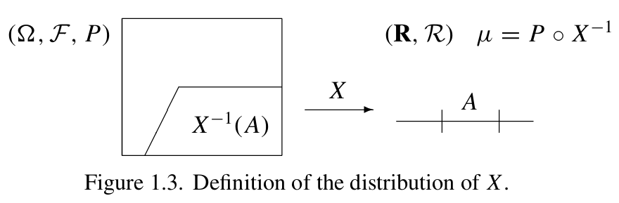

# 1 Measure Theory
## 1.1 Probability Space
A **probability space** is a triple ($\Omega,\mathcal{F},P$) where $\Omega$ is a set of outcomes, $\mathcal{F}$ is a set of events, and $P:\mathcal{F} \to [0,1]$ is a function that assigns probabilities to events.  
We assume $\mathcal{F}$ is a $\sigma$-field which is a collection of subsets of $\Omega$ that satify  

(i)  if $A \in \mathcal{F}$ then $A^C \in \mathcal{F}$,and  
(ii)  if $A_i \in \mathcal{F}$ is a countable sequence of sets then $\cup_i A_i \in \mathcal{F}$.  

It's easy to prove that a $\sigma$-field is closed under countable intersections.  

Without $P$, $(\Omega, \mathcal{F})$ is called a **measurable space**, A **measure** is a nonnegative countably additive set function: $\mu: \mathcal{F} \to \mathbf{R}$ with  

(i)  $\mu(A) \geq \mu(\empty) = 0$ for all $A \in \mathcal{F}$, and  
(ii)  if $A_i \in \mathcal{F}$ is a countable sequence of disjoint sets, then  

$$
\mu(\cup_i A_i) = \sum_i \mu(A_i)
$$

If $\mu(\Omega)=1$,we call $\mu$ a **probability measure**.  

$$
\begin{aligned}
& \textbf{Theorem 1.1.1.} \textit{ Let } \mu \textit{ be a measure on } (\Omega, \mathcal{F}) \\
& (i) \textbf{ Monotonicity.} \textit{ If } A \subset B \textit{ then } \mu(A) \le \mu(B). \\
& (ii) \textbf{ Subadditivity.} \textit{ If } A \subset \cup_{m=1}^\infty A_m \textit{ then } \mu(A) \le \sum_{m=1}^\infty \mu(A_m). \\
& (iii) \textbf{ Continuity from below.} \textit{ If } A_i \uparrow A \textit{ (i.e., } A_1 \subset A_2 \subset \dots \textit{ and } \cup_i A_i = A) \textit{ then} \\
& \qquad \mu(A_i) \uparrow \mu(A). \\
& (iv) \textbf{ Continuity from above.} \textit{ If } A_i \downarrow A \textit{ (i.e., } A_1 \supset A_2 \supset \dots \textit{ and } \cap_i A_i = A), \textit{ with} \\
& \qquad \mu(A_1) < \infty \textit{ then } \mu(A_i) \downarrow \mu(A).
\end{aligned}
$$

Let $\mathbf{R}^d$ be the set of vectors $(x_1,...,x_d)$ of real numbers and $\mathcal{R}^d$ be the **Borel sets**, the smallest $\sigma$-field containing the open sets.  

Measures on $(\mathbf{R},\mathcal{R})$ are defined by giving probability a **Stieltjes measure function** with the following properties:  

(i)  $F$ is nondecreasing.  
(ii)  $F$ is right continous.  

$$
\begin{aligned}
& \textbf{Theorem 1.1.2.} \textit{ Associated with each Stieltjes measure function } F \textit{ there is a unique} \\
& \textit{measure } \mu \textit{ on } (\mathbf{R}, \mathcal{R}) \textit{ with } \mu(a, b]) = F(b) - F(a) \\
& \qquad\qquad\qquad\qquad\qquad\qquad\quad \mu((a, b]) = F(b) - F(a)
\end{aligned}
$$

When $F(x) = x$ the resulting measure is called **Lebesgue measure**.  

The choice of "closed on the right" in $(a,b]$ is dictated by the fact that if $b_n \downarrow b$ then we have

$$
\cap_n (a, b_n] = (a, b]
$$

A collection $\mathcal{S}$ of sets is said to be a **semialgebra** if  

(i)  it is closed under intersection.  
(ii)  if $S \in \mathcal{S}$ then ${S}^C$ is a finite disjoint union of sets in $\mathcal{S}$.  

$Example:$ $\mathcal{S}_d = $ the empty set plus all sets of the form  

$$
(a_1, b_1] \times \cdots \times (a_d, b_d] \subset \mathbf{R}^d \quad \text{where} \quad -\infty \le a_i < b_i \le \infty
$$

$$
\begin{aligned}
& \textbf{Lemma 1.1.3.} \textit{ If } \mathcal{S} \textit{ is a semialgebra, then } \bar{\mathcal{S}} = \{\textit{finite disjoint unions of sets in } \mathcal{S}\} \\
& \textit{is an algebra, called the } \textbf{algebra generated by } \mathcal{S}.
\end{aligned}
$$

$\mu$ is said to be $\sigma$-finite if there is a sequence of sets $A_n \in \mathcal{A}$ so that $\mu(A_n) < \infty$ and $\cup_n A_n = \Omega$.  

$$
\begin{aligned}
& \textbf{Theorem 1.1.4.} \textit{ Let } \mathcal{S} \textit{ be a semialgebra and let } \mu \textit{ defined on } \mathcal{S} \textit{ have } \mu(\emptyset) = 0. \\
& \textit{Suppose (i) if } S \in \mathcal{S} \textit{ is a finite disjoint union of sets } S_i \in \mathcal{S} \textit{ then } \mu(S) = \sum_i \mu(S_i), \\
& \textit{and (ii) if } S_i, S \in \mathcal{S} \textit{ with } S = +_{i \ge 1} S_i \textit{ then } \mu(S) \le \sum_{i \ge 1} \mu(S_i). \textit{ Then } \mu \textit{ has a unique} \\
& \textit{extension } \bar{\mu} \textit{ that is a measure on } \bar{\mathcal{S}} \textit{ the algebra generated by } \mathcal{S}. \textit{ If } \bar{\mu} \textit{ is sigma-finite} \\
& \textit{then there is a unique extension } \nu \textit{ that is a measure on } \sigma(\mathcal{S}).
\end{aligned}
$$

$$
\begin{aligned}
& \textbf{Lemma 1.1.5.} \textit{ Suppose only that (i) holds.} \\
& (a) \textit{ If } A, B_i \in \bar{\mathcal{S}} \textit{ with } A = +_{i=1}^n B_i \textit{ then } \bar{\mu}(A) = \sum_i \bar{\mu}(B_i). \\
& (b) \textit{ If } A, B_i \in \bar{\mathcal{S}} \textit{ with } A \subset \cup_{i=1}^n B_i \textit{ then } \bar{\mu}(A) \le \sum_i \bar{\mu}(B_i).
\end{aligned}
$$

$\text{Proof: page5}$  
$\text{Proof of Theorem 1.1.2: page5-6}$

We first introduce the assumptions on the defining function $F$:  

(i)  It is nondecreasing, that is, if $x \geq y$(meaning $x_i \geq y_i$ for all $i$), then $F(x) \geq F(y)$.  
(ii)  $F$ is right continuous, that is, $lim_{y \downarrow x} F(y)=F(x)$.  
(iii)  $\Delta_A F \geq 0$ for all rectangles $A$.  

$$
\begin{aligned}
& \textbf{Theorem 1.1.6.} \textit{ Suppose } F : \mathbf{R}^d \to [0, 1] \textit{ satisfies (i)--(iii) given above. Then there} \\
& \textit{is a unique probability measure } \mu \textit{ on } (\mathbf{R}^d, \mathcal{R}^d) \textit{ so that } \mu(A) = \Delta_A F \textit{ for all finite} \\
& \textit{rectangles.}
\end{aligned}
$$

$Example:$ Suppose $F(x) = \prod_{i=1}F_i(x)$, where the $F_i$ satisfy (i) and (ii) of Theorem 1.1.2. In this case,

$$
\Delta_A F = \prod_{i=1}^d (F_i(b_i) - F_i(a_i))
$$

When $F_i(x) = x$ for all $i$, the resulting measure is Lebesgue measure on $\mathbf{R}^d$.  

$\text{Proof of Theorem 1.1.6 is similar to that of Theorem 1.1.2: page7-8}$  

## 1.2 Distributions  
A real-valued function $X$ defined on $\Omega$ is said to be a **random
variable** if for every Borel set $B \in \mathbf{R}$ we have $X_{-1}(B) ={\omega : X(\omega) \in B} \in F$.  

If $X$ is a random variable, then $X$ induces a probability measure on $\mathbf{R}$ called its **distribution** by setting $\mu(A) = P(X \in A)$ for Borel sets $A$.  

  

The distribution of a random variable $X$ is usually described by giving its **distribution function**, $F(x) = P(X \le x)$.  

$$
\begin{aligned}
& \textbf{Theorem 1.2.1.} \textit{ Any distribution function } F \textit{ has the following properties:} \\
& (i) \ F \textit{ is nondecreasing.} \\
& (ii) \ \lim_{x \to \infty} F(x) = 1, \lim_{x \to -\infty} F(x) = 0. \\
& (iii) \ F \textit{ is right continuous, that is, } \lim_{y \downarrow x} F(y) = F(x). \\
& (iv) \textit{ If } F(x-) = \lim_{y \uparrow x} F(y) \textit{ then } F(x-) = P(X < x). \\
& (v) \ P(X = x) = F(x) - F(x-).
\end{aligned}
$$

$$
\begin{aligned}
& \textbf{Theorem 1.2.2.} \textit{ If } F \textit{ satisfies (i), (ii), and (iii) in Theorem 1.2.1, then it is the} \\
& \textit{distribution function of some random variable.}
\end{aligned}
$$

$Proof:$  
Let $\Omega = (0,1)$, $F =$ the Borel sets, and $P =$ Lebesgue measure. If $\omega \in (0,1)$, let  

$$
X(\omega) = \sup\{y : F(y) < \omega\}
$$

if $\omega \le F(x)$ then $X(\omega) \le x $, since $x \notin {y : F(y) < \omega }$.  

On the other hand if $\omega > F(x)$, then since $F$ is right
continuous, there is an $\epsilon > 0 $ so that $F(x + \epsilon) < \omega $ and $X(\omega) \geq x +\epsilon > x $.

So we have  

$$
\lbrace \omega : X(\omega) \le x \rbrace = \lbrace \omega : \omega \le F(x) \rbrace
$$

$$
P(\omega : \omega \le F(x)) = F(x)
$$  

$Q.E.D.$ 

If $X$ and $Y$ induce the same distribution $\mu$ on $(\mathbf{R},\mathcal{R})$, we say $X$ and $Y$ are equal in distribution. 

$$
X \overset{d}{=} Y
$$

When the distribution function $F(x) = P(X \le x)$ has the form:  

$$
F(x) = \int_{-\infty}^{x} f(y) dy
$$

we say that $X$ has **density function** $f$  

$$
P(X = x) = \lim_{\epsilon \to 0} \int_{x-\epsilon}^{x+\epsilon} f(y) dy = 0
$$

$Example 1.2.1:$ **Uniform distribution on (0,1).**  
$f(x) = 1$ for $x \in (0,1)$ and $0$ otherwise.

$$
F(x) = \begin{cases}
0 & x \le 0 \\
x & 0 \le x \le 1 \\
1 & x > 1
\end{cases}
$$

$Example 1.2.2:$  **Exponential distribution with rate $\lambda$.**  
$f(x) = \lambda e^{−\lambda x}$ for $x \geq 0$ and $0$ otherwise.  

$$
F(x) = \begin{cases}
0 & x \le 0 \\
1 - e^{-x} & x \ge 0
\end{cases}
$$

$Example 1.2.3:$ **Standard normal distribution.**  

$$
f(x) = (2\pi)^{-1/2} \exp(-x^2/2)
$$

$$
(x^{-1} - x^{-3}) \exp(-x^2/2) \le \int_x^\infty \exp(-y^2/2) dy \le x^{-1} \exp(-x^2/2)
$$

$Example 1.2.4:$ **Uniform distribution on the Cantor set.**  
$F(x) = 0 \text{ for } x \le 0$, $F(x) = 1 \text{ for } x \ge 1$, $F(x) = 1/2 \text{ for } x \in [1/3,2/3]$, $F(x) = 1/4 \text{ for } x \in [1/9,2/9]$, $F(x) = 3/4 \text{ for } x \in [7/9,8/9]$,...  

$Example 1.2.5:$ **Point mass at $0$.**  

$Example 1.2.6:$ **Dense discontinuities.**  
Let $q_1, q_2,...$ be an enumeration of the rationals. Let $\alpha_i > 0$ have $\sum_{i=1}^{\infty} α_i = 1$ and let  

$$
F(x) = \sum_{i=1}^\infty \alpha_i \mathbf{1}_{[q_i, \infty)}
$$

## 1.3 Random Variables